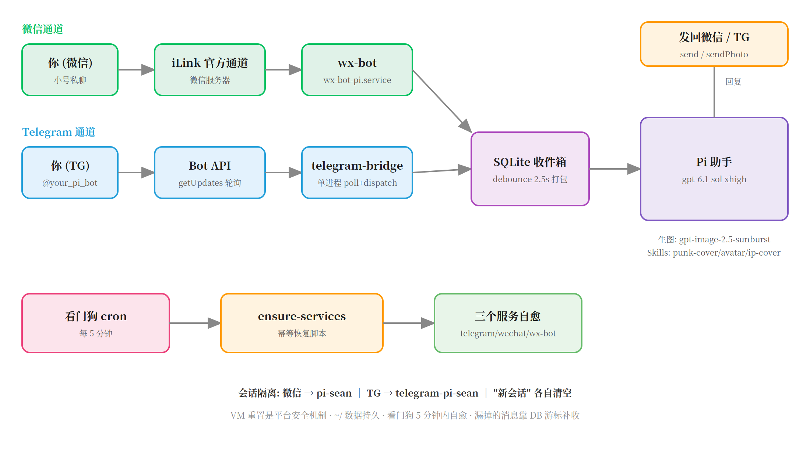
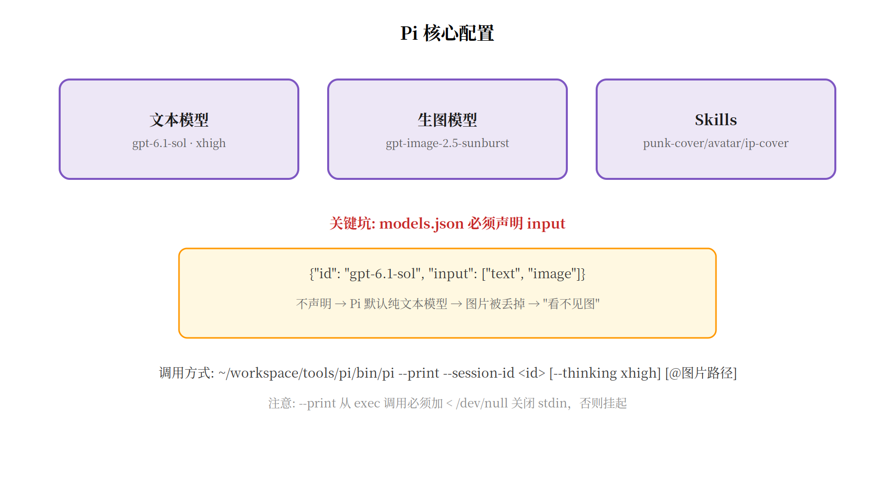
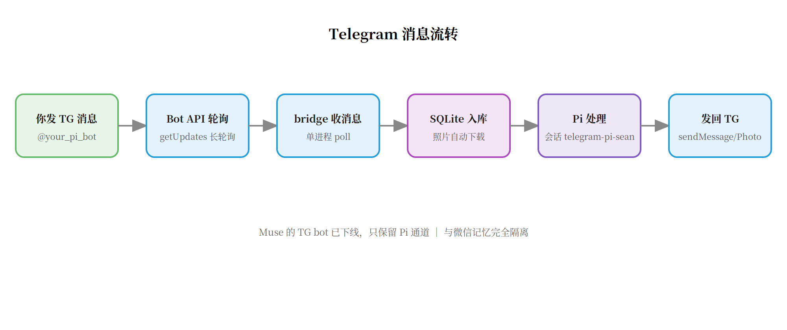
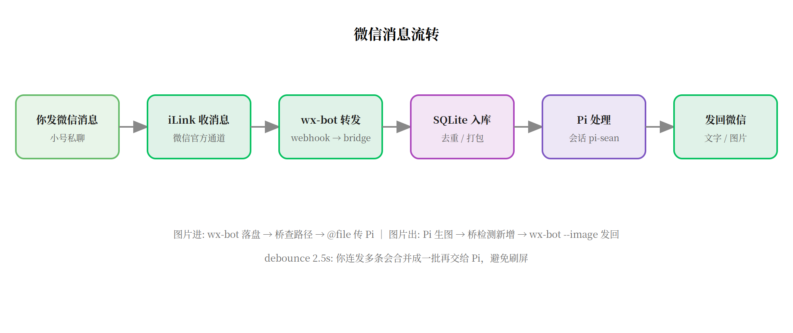
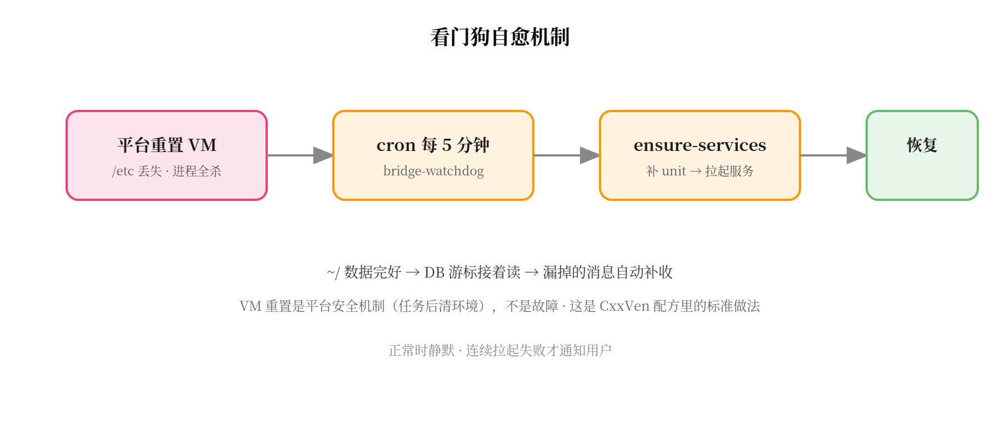

# 微信 + Telegram 双通道接入 Pi 完整教程

> 在微信和 Telegram 里直接跟你的 AI 助手聊天：发文字、发图片、让它生图、P 图，全都行。
> 本文记录一套真实跑通的方案，包含所有踩过的坑。

---

## 1. 效果展示

搭完之后，你得到的是这样一套东西：

- **微信**：用一个微信小号跟 Pi 聊天。发文字秒回（约 10-20 秒），发照片它能看懂，你说"帮我换个背景"，它能理解图里的内容。
- **Telegram**：一个专属 bot（`@你的_pi_bot`），同样跟 Pi 聊天。Pi 还能直接生图发给你。
- **记忆**：微信和 TG 各有独立的会话记忆，互不干扰。想清空就发"新会话"。
- **自愈**：云服务器被平台重置后，5 分钟内服务自动恢复，不用你管。



---

## 2. 整体架构

```
你（微信小号） → iLink 官方通道 → wx-bot → 桥接服务 → SQLite → Pi → 发回微信
你（Telegram） → Bot API 轮询 → telegram-bridge → SQLite → Pi → 发回 TG
                                                        ↓
                                              看门狗 cron（每 5 分钟自愈）
```

核心设计决策：

| 决策 | 选择 | 原因 |
|------|------|------|
| 微信通道 | 官方 iLink / Bot 通道 | 微信官方开放能力，比逆向协议稳定 |
| 响应模型 | Pi（不是 Muse） | Pi 可装 skills、配私有模型；Muse 只在 App 里用 |
| 会话 | 微信/TG 隔离 | 两端场景不同，混在一起很奇怪 |
| 数据 | SQLite 本地 | 去重、防双发、断点续传 |
| 自愈 | cron 定时检查 | 云 VM 会被平台重置，必须能自己爬起来 |

---

## 3. 准备工作

### 3.1 一台云服务器（或本地常开机的机器）

需要能跑 Node.js + SQLite，7x24 在线。本文用的是 Muse 的云 VM（会被平台周期性重置——后面有专门的应对方案）。

### 3.2 Pi coding agent

Pi 是一个 AI 编程/助手 agent，支持：
- 配置私有模型（本文用 sub2api 中转站）
- 安装 skills（专项技能包）
- `--print` 非交互模式（适合被程序调用）
- 持久会话（`--session-id`）

安装：
```bash
# 持久化安装（不要装 /usr/bin，VM 重置会丢）
npm install --prefix ~/workspace/tools/pi --ignore-scripts
```

### 3.3 Telegram bot

1. 找 @BotFather 创建 bot，拿到 token
2. 记下你自己的 Telegram user ID（白名单用，只允许你一个人用）

### 3.4 微信小号

准备一个微信小号（**不要用大号**），用于扫码登录 iLink Bot 通道。

官方限制（实测）：
- 只支持一对一私聊，不支持群聊
- 不能主动发起对话（必须你先发消息）
- 连续发约 10 条不回复会被限流

---

## 4. Pi 配置（关键）

### 4.1 模型配置

`~/.pi/agent/models.json`：

```json
{
  "providers": {
    "sub2api": {
      "api": "openai-completions",
      "apiKey": "!cat /home/你的用户名/.pi/agent/.sub2api_key",
      "baseUrl": "https://你的中转站/v1",
      "models": [
        { "id": "gpt-6.1-sol", "input": ["text", "image"] }
      ]
    }
  }
}
```

`~/.pi/agent/settings.json`：

```json
{
  "defaultModel": "sub2api/gpt-6.1-sol",
  "defaultThinkingLevel": "xhigh"
}
```

### 4.2 最大坑：`input` 声明

**这是本文最有价值的一个发现。**

Pi 的 `--print` 模式其实是支持看图的（`@图片路径` 参数）。但如果 `models.json` 里没有给模型声明 `"input": ["text", "image"]`，Pi 会默认它是纯文本模型，**静默丢掉你传的图片**，然后一本正经地回你"我看不见图"。

我们排查了整整一轮：查 Pi 源码确认图片确实进了会话 → 发现模型配置缺 `input` 字段 → 补上后立刻就能看图了。



### 4.3 生图模型

单独配一个图片生成 provider（本文用 `sub2api-img`）：

```json
"sub2api-img": {
  "api": "openai-images",
  "baseUrl": "https://你的中转站/v1",
  "models": [{ "id": "gpt-image-2.5-sunburst" }]
}
```

文本对话走 `gpt-6.1-sol`，生图走 `gpt-image-2.5-sunburst`，各干各的。

### 4.4 Skills

Pi 支持安装 skills（可复用的技能包）。本文装了三个图片类 skill：
- `punk-cover`：封面海报
- `punk-avatar`：头像生成
- `punk-ip-video-cover`：人物视频封面

Pi 会自主判断什么时候调用 skill，不用你在提示词里写死。

### 4.5 调用方式

桥接服务这样调 Pi：

```bash
# 文字对话（持久会话）
pi --print --session-id pi-sean < /dev/null

# 带图片
pi --print --session-id pi-sean @/path/to/image.jpg < /dev/null
```

**注意**：从程序调用 `pi --print` 必须重定向 stdin（`< /dev/null`），否则 Pi 会挂起等输入。

---

## 5. Telegram 通道搭建



### 5.1 配置

`config/telegram.json`（权限 600，token 绝不进代码仓库）：

```json
{
  "telegram": {
    "pi_bot_token": "你的bot token",
    "allowed_user_ids": ["你的TG user ID"],
    "api_base": "https://api.telegram.org",
    "debounce_ms": 2500
  }
}
```

### 5.2 桥接服务

`telegram-bridge.mjs` 做三件事（单进程）：
1. **poll loop**：`getUpdates` 长轮询收消息
2. **dispatch loop**：debounce 打包 → 调 Pi → 发回 TG
3. **图片处理**：收到的照片自动下载，`sendPhoto` 发图

消息流程：
```
getUpdates → 白名单校验 → SQLite inbox → debounce 2.5s →
打包 → Pi (--session-id telegram-pi-sean) → sendMessage / sendPhoto
```

debounce 的作用：你连发 3 条消息，2.5 秒内会合并成一批再交给 Pi，避免 Pi 被刷屏。

### 5.3 systemd 服务

```ini
[Service]
# 代理（Node 24 fetch 需要）
Environment=HTTPS_PROXY=...
Environment=NODE_USE_ENV_PROXY=1
# Pi 按 HOME 找配置
Environment=HOME=/home/你的用户名
# 内存上限
ExecStart=/usr/bin/node --max-old-space-size=128 app/telegram-bridge.mjs
```

**坑**：代理环境变量必须写在 `[Service]` 段下，写到 `[Install]` 下会被 systemd 静默忽略，然后你就会看到满屏的 `fetch failed`。

---

## 6. 微信通道搭建



### 6.1 iLink 扫码登录

走微信官方 iLink Bot 通道：

1. 调 `get_qrcode` 接口拿二维码
2. 手机微信扫码确认
3. 保存返回的 `bot_token`（失效信号是 `errcode=-14`，没有 refresh 机制，失效后要重新扫码）

### 6.2 wx-bot

用社区开源的 `wx-bot`（iLink 协议客户端）：
- `wx-bot run`：长轮询收消息 → 转发到本地 webhook
- `wx-bot send`：发文字 / `--image` 发图片

### 6.3 桥接服务

`wechat-bridge.service` 跑 `server.mjs`：
- 接收 wx-bot 的 webhook
- SQLite 入库、debounce 打包
- 调 Pi（会话 `pi-sean`）
- 文字经 `wx-bot send` 发回，图片经 `wx-bot send --image` 发回

图片接收：wx-bot 会把图片落盘到 `state/wx-pi/media/`，桥查到路径后以 `@file` 传给 Pi。

---

## 7. 看门狗：应对云 VM 重置



### 7.1 为什么需要

Muse 的云 VM 会被平台**周期性重置**（安全机制：任务后清理环境）。重置后：
- `/etc/` 下的 systemd unit 全丢
- 所有进程被杀
- `~/` 数据完好（SQLite、配置都在）

表现就是"bot 突然不回消息了"。

### 7.2 方案

一个幂等恢复脚本 `bin/ensure-services`：
- unit 缺失 → 从 workspace 模板拷贝恢复
- 服务未 active → 启动

配一个每 5 分钟的 cron 定时跑它（用平台托管的 cron，跨 VM 重置存活）：

```
每 5 分钟 → ensure-services → 三个服务自愈
```

正常时静默，连续拉起失败才通知。实测：VM 重置后 5 分钟内服务自动恢复，漏掉的消息靠 DB 游标补收。

> 这是社区验证过的标准做法（CxxVen 的微信接入配方里第 5 步就是这个）。

---

## 8. 测试验证清单

按这个顺序测，全过才算跑通：

- [ ] 微信发"你好"，Pi 文字回复
- [ ] TG 发"你好"，Pi 文字回复
- [ ] 微信发照片 + "这是什么"，Pi 能描述图里内容
- [ ] TG 发照片 + "帮我换个背景"，Pi 能看到图
- [ ] TG 发"生成一张国庆海报"，Pi 生图并自动发回
- [ ] 微信发"新会话"，再聊天确认记忆已清空
- [ ] 微信聊 A 话题，切 TG 聊 B 话题，确认两边记忆不串
- [ ] 手动 kill 服务，5 分钟后确认看门狗拉起

---

## 9. 常见坑汇总

| 坑 | 现象 | 根因 | 解法 |
|----|------|------|------|
| Pi 看不见图 | "我无法查看这张图片" | `models.json` 缺 `input` 声明 | 加 `"input": ["text", "image"]` |
| Pi 调用挂起 | 命令卡死无输出 | `--print` 等 stdin | 加 `< /dev/null` |
| TG 收不到消息 | poll 报 `fetch failed` | systemd 干净环境缺代理 | 代理写 `[Service]` 段 + `NODE_USE_ENV_PROXY=1` |
| Pi 找不到配置 | 报配置错误 | systemd 的 HOME 不对 | `Environment=HOME=/home/你的用户名` |
| 微信发不出去 | 无报错但没收到 | iLink 参数细节 | 检查 `from_user_id=""`、`message_type=2` 等 |
| Token 失效 | 突然全不回 | iLink `errcode=-14` | 重新扫码登录（无 refresh） |
| 服务突然全挂 | bot 不回消息 | VM 被平台重置 | 看门狗 5 分钟自愈 |
| 内存偏高 | VM 内存告警 | 多进程 + 无上限 | 单进程 + `--max-old-space-size=128` |

---

## 10. 架构取舍

**为什么不用 CxxVen 的 Python 版？**

他的配方（X 上 4 万浏览，评论区多人跑通）是 Python 手写 iLink 协议，简单直接。但我们选了 Node + 社区 wx-bot 的路线：

- wx-bot 把 iLink 协议细节封装好了，不用自己拼 header
- SQLite：去重、防双发、debounce、会话持久化
- 图片双向、"新会话"命令都是后加的，他那版没有

简单说：**他的适合"半小时搭起来玩玩"，我们的适合"长期稳定跑"**。两条路线的 iLink 通道、看门狗思路是相通的。

---

*教程版本：2026-10-11 · 基于真实跑通的系统整理*
*官方限制：微信小号、一对一私聊、不能主动发起对话、注意 -14 重新扫码*
